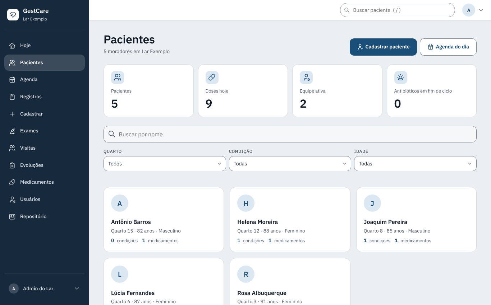
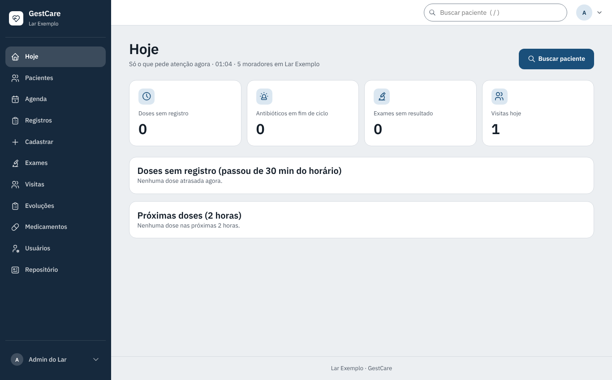
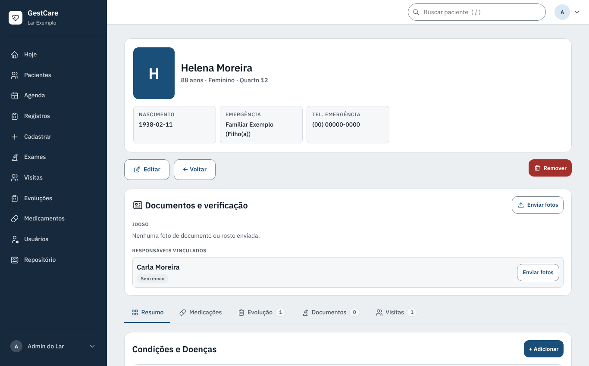
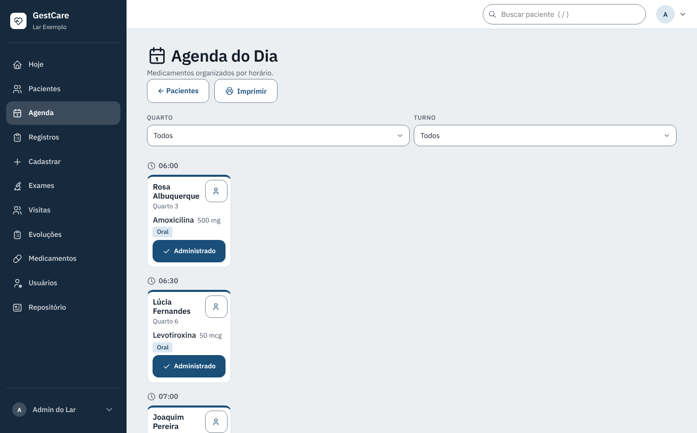
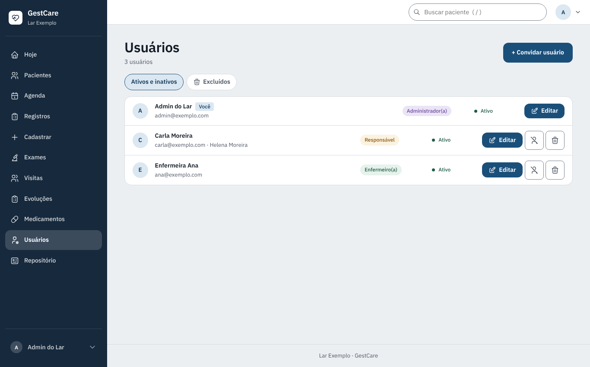
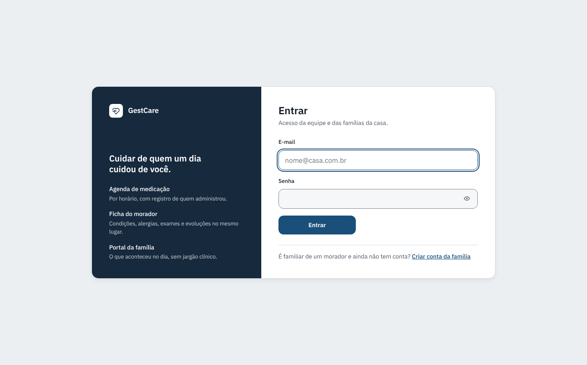
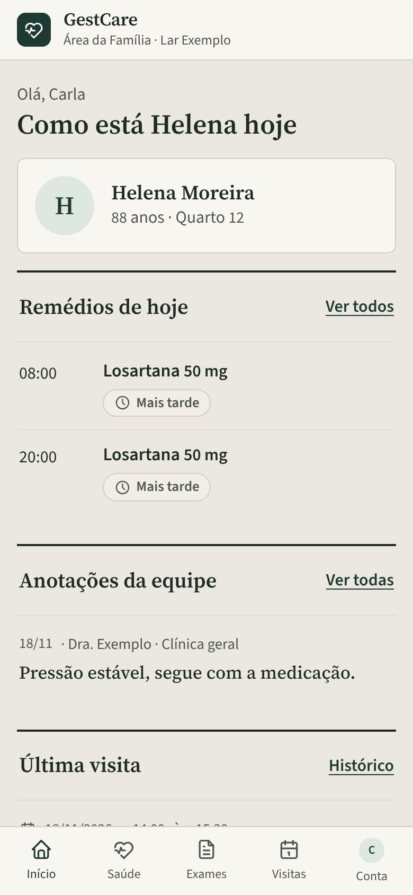

# GestCare

Sistema web para organizar a rotina de **lares de idosos** (casas de repouso e instituições de longa permanência): cadastro dos moradores, remédios e horários, exames, visitas, anotações da equipe e uma área própria para a família acompanhar o idoso pelo celular.

Projeto desenvolvido originalmente como Projeto Integrador (UNISAL) e depois evoluído para uso real.



## O problema que ele resolve

Muitos lares de idosos ainda controlam informações importantes (que remédio dar e quando, exames, visitas) em papel ou em planilhas soltas. O GestCare junta tudo em um só lugar, mostra para a equipe o que precisa de atenção agora e dá à família uma janela de acompanhamento, sem que ninguém precise ligar para perguntar.

## Funcionalidades

**Para a equipe do lar**

- **Hoje:** painel com o que pede atenção agora (doses atrasadas, próximas doses, antibióticos terminando, exames sem resultado, visitas do dia).
- **Pacientes:** lista com busca e filtros por quarto, condição e idade.
- **Ficha do paciente:** dados pessoais, contato de emergência, condições e doenças, ficha psicológica, nutrição e dieta, profissionais consultados.
- **Medicamentos e agenda:** cadastro de remédios com horários; a agenda do dia mostra cada dose e permite marcar como dada.
- **Lembretes de antibiótico:** aviso (notificação no celular) quando um tratamento está chegando ao fim.
- **Exames, visitas e evoluções:** registro de exames (com arquivo anexo), visitas da família e anotações da equipe de saúde.
- **Usuários e perfis:** cada pessoa entra com o seu login e só vê o que o seu perfil permite (administrador, enfermagem, responsável). Exclusão de usuário é reversível.
- **Repositório de identidade:** guarda foto do documento e do rosto de idosos e responsáveis, com consentimento registrado. Pode comparar o rosto com o documento e ler o CPF da foto, tudo no próprio servidor (nenhuma imagem é enviada para fora).

**Para a família (portal do responsável)**

- Remédios do dia, anotações da equipe, exames e histórico de visitas do idoso, em uma tela pensada para celular.
- O acesso só é liberado depois que o lar confere a identidade do responsável.

**Para quem administra o sistema**

- Um mesmo GestCare atende **várias casas** ao mesmo tempo. O superadministrador cadastra as casas, e cada casa só enxerga os próprios dados.
- Funciona como aplicativo instalável no celular (PWA), com tema claro e escuro.

## Telas

| Hoje | Ficha do paciente |
|---|---|
|  |  |

| Agenda de doses | Usuários |
|---|---|
|  |  |

| Login | Portal da família (celular) |
|---|---|
|  |  |

> Todas as telas usam dados **fictícios**, criados só para estas imagens.

## Tecnologias

- **Python 3.10+** com **Flask** (servidor web)
- **SQLite** (banco de dados em arquivo, sem instalar nada a mais)
- **HTML, CSS e JavaScript** puros, com Service Worker para funcionar como aplicativo (PWA)
- **bcrypt** para guardar senhas de forma segura, **APScheduler** para tarefas agendadas, **pywebpush** para notificações
- **waitress** para rodar em produção
- Opcional: **dlib** e **RapidOCR** para a verificação de identidade (rodam localmente)

## Como rodar no seu computador

Você precisa do [Python](https://www.python.org/downloads/) 3.10 ou mais novo.

```bash
# 1. Baixar o projeto
git clone https://github.com/ArthurSouzaDeveloper/GestCare.git
cd GestCare

# 2. Criar um ambiente isolado para as bibliotecas
python -m venv venv
venv\Scripts\activate        # Windows
source venv/bin/activate     # Linux ou Mac

# 3. Instalar as bibliotecas
pip install -r requirements.txt

# 4. Criar o primeiro usuário (superadministrador)
python criar_superadmin.py

# 5. Ligar o sistema
python app.py
```

Abra **http://localhost:5000** no navegador e entre com o usuário mostrado no passo 4 (`superadmin@gestcare.com` / `superadmin123`). Troque essa senha depois do primeiro acesso.

O banco de dados é criado sozinho, vazio, na pasta `database/` na primeira vez que o sistema liga.

### Primeiros passos dentro do sistema

1. Como superadministrador, cadastre uma **casa** em *Casas → + Nova Casa*. Nesse cadastro você já define o e-mail e a senha do administrador daquela casa.
2. Saia e entre com o administrador da casa. Agora você pode cadastrar pacientes, remédios, usuários da equipe, exames e visitas.
3. Para testar o portal da família, crie um usuário com perfil **responsável** vinculado a um paciente.

### Configurações opcionais

| O quê | Como |
|---|---|
| **Chave secreta** (obrigatória em produção) | Defina a variável de ambiente `GESTCARE_SECRET_KEY` com um texto longo e aleatório. Sem ela, o sistema funciona, mas usa uma chave de teste e mostra um aviso. |
| **Notificações no celular** | Coloque uma chave VAPID no arquivo `vapid_private_key.pem` na pasta do projeto. Sem o arquivo, o sistema funciona normalmente, só sem notificações. |
| **Verificação de identidade automática** | `pip install -r requirements-verificacao.txt` (cerca de 540 MB). Sem isso, as fotos são recebidas e vão para conferência manual. |
| **Modo produção** | `python servidor.py` em vez de `python app.py`. |

### Testes automáticos

```bash
pip install pytest numpy pillow
python -m pytest tests -q
```

## Como o projeto está organizado

```
GestCare/
├── app.py                      # O sistema: rotas (páginas), regras e banco de dados
├── verificacao_identidade.py   # Comparação de rosto e leitura de CPF (opcional)
├── logger.py                   # Registros de uso, sem gravar senhas nem CPF
├── servidor.py                 # Liga o sistema em modo produção (waitress)
├── tarefa_lembretes.py         # Checagem diária de antibióticos (para rodar agendado)
├── criar_superadmin.py         # Cria o primeiro usuário
├── templates/                  # Páginas HTML (Jinja2)
│   ├── familia/                # Páginas do portal da família
│   └── partials/               # Pedaços reaproveitados (menu, ícones)
├── static/
│   ├── css/                    # Visual (tema claro e escuro)
│   ├── js/app.js               # Comportamentos da interface
│   ├── icons/ e manifest.json  # Ícones e dados do aplicativo instalável
│   └── sw.js                   # Service Worker (PWA e notificações)
├── tests/                      # Testes automáticos (pytest)
└── docs/telas/                 # Imagens usadas neste README
```

Pastas criadas pelo sistema enquanto ele roda, e que **não vão para o GitHub**: `database/` (banco), `uploads/` (exames e fotos de documentos) e `vapid_private_key.pem`.

## Segurança e privacidade

- Senhas são guardadas com bcrypt, nunca em texto.
- Todos os formulários têm proteção contra envio forjado (CSRF) e os cookies de sessão são protegidos.
- Cada casa só vê os próprios pacientes; cada perfil só acessa as telas que lhe cabem.
- Arquivos de exames e fotos de identidade ficam fora da pasta pública e só são entregues para quem tem permissão.
- Os registros (logs) escondem senhas, tokens e CPF.
- Nenhum dado real de paciente fica no repositório: banco, arquivos enviados e chaves estão no `.gitignore`.

## Autor

Desenvolvido por **Arthur Souza** · [GitHub](https://github.com/ArthurSouzaDeveloper)
